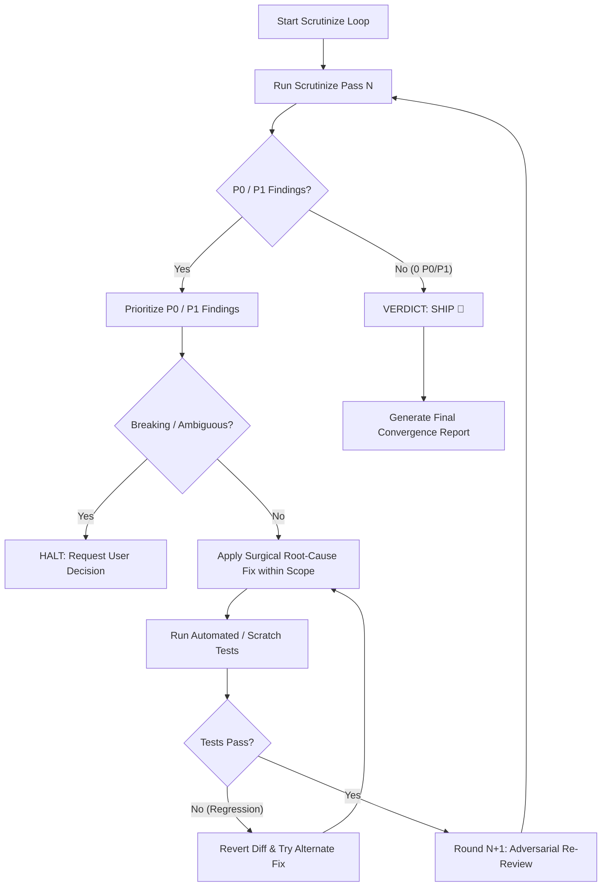

# Scrutinize Loop (Iterative Review & Repair Engine)

An autonomous convergence loop that combines outsider-perspective scrutiny with surgical repairs. It iterates continuously: **Review → Prioritize → Fix → Validate → Re-Review** until the codebase reaches **Zero Actionable Findings (VERDICT: SHIP)**.

> [!IMPORTANT]
> **Prerequisite:** This skill strictly requires the **`scrutinize`** skill (`scrutinize/SKILL.md`) as its foundational review engine. Read and adhere to `scrutinize`'s 3-step evaluation discipline (Intent → Trace → Verify) on every pass.

---

## 🛡️ Anti-Hallucination & Safety Guardrails

To prevent LLMs from hallucinating, self-confirming bad fixes, oscillating, cheating tests, or entering infinite loops:

1. **Adversarial Posture on Re-Review (Cold-Eye Re-Scrutiny)**:
   - When reviewing your own fixes from previous rounds, **do not assume the fix was correct**.
   - Treat the new code as if written by an outsider. Actively look for secondary bugs, broken edge cases, null pointer regressions, or unhandled concurrency introduced by the fix.

2. **Immutable Test Invariants (No Test Cheating)**:
   - **Never modify, weaken, or delete existing test assertions** simply to make the test suite green.
   - Fix the actual implementation to fulfill the contract. If a test assertion is legitimately broken or obsolete due to an approved requirement change, escalate and confirm with the user before touching test logic.

3. **Clean-Slate Rollback on Regression**:
   - If a proposed fix causes new test failures, syntax errors, or compounds defects, **immediately revert the diff** (`git checkout` / undo changes) before testing a new hypothesis.
   - **Never stack hacky fixes on top of broken patches.** Always return to the last known working state before attempting an alternative fix.

4. **Strict Scope Clamping (Blast Radius Control)**:
   - Confine all surgical fixes strictly within the target module/files.
   - Do not refactor external or unrelated files without explicit user consent, even if you spot minor code smells in those files.

5. **No Design Oscillation**:
   - Never flip-flop between two architectural or stylistic choices (e.g. splitting vs inlining a function) across rounds.
   - Once a fix is applied, do not revert it in a subsequent round unless proven broken by an explicit test failure.

6. **Zero-Test Fallback (Test Rigor)**:
   - If automated test suites (`pytest`, `npm test`, etc.) exist, run them on every round.
   - If **no automated test suite exists**, create a temporary reproduction/validation script (e.g. in a scratch folder or memory test) or conduct a verifiable step-by-step trace table. Never claim a fix works without running or tracing execution.

7. **Escalation Gate (Human-in-the-Loop)**:
   - If a defect stems from **ambiguous requirements**, requires **breaking public API contracts**, or needs **database schema migrations**, **HALT the loop immediately**.
   - Present the trade-offs to the user and ask for explicit direction instead of guessing.

8. **Convergence Threshold & Nit Policy**:
   - **P0 (Blockers)**: 0 allowed. Must be fixed.
   - **P1 (Defects)**: 0 allowed. Must be fixed.
   - **P2 (Nits/Cosmetic)**: Note them in the report, but **do not block the loop from converging**. Do not churn infinite rounds on minor stylistic preferences.
   - **Safety Limit**: Maximum **5 iterations**. If findings do not converge to zero within 5 rounds, halt, summarize remaining blockers, and request user guidance.

---

## The Convergence Loop Protocol



---

## Detailed Step-by-Step Workflow

### Step 1: Initialize Scope & Baseline
- Identify target files, modules, PRs, or feature boundaries.
- Ensure all prerequisite skills (`scrutinize`, `debug-mantra`) are loaded.
- Initialize the iteration counter: `Round = 1`.

### Step 2: Execute Scrutinize Pass
Apply the full 3-step `scrutinize` workflow:
1. **Intent**: What is the code/feature trying to do? Is there a simpler, more elegant architecture?
2. **Trace**: Walk the actual runtime code paths, entry points, state mutations, error branches, and call sites.
3. **Verify**: Test edge cases, concurrency, race conditions, memory leaks, boundary limits, and silent regressions.

### Step 3: Decision Gate (Evaluate Findings)
- **If 0 P0/P1 findings found**:
  - Output `VERDICT: SHIP`.
  - Proceed to Step 6 (Final Convergence Report) and terminate loop.
- **If P0/P1 findings found**:
  - Check for Escalation Gate: If requirement is ambiguous or breaks API contract, pause and ask the user.
  - Itemize each finding with severity:
    - **P0 (Blocker)**: Crashes, data corruption, security vulnerability, deadlocks.
    - **P1 (Defect)**: Functional failure, race condition, resource leak, broken contract.
    - **P2 (Quality/Edge)**: Unhandled edge case, layout defect, ungraceful error message.
  - Proceed to Step 4.

### Step 4: Surgical Repair & Refactor
- Formulate a precise fix for each finding.
- Modify code surgically with minimal diff footprints strictly within the target scope.
- Preserve documentation integrity and existing comments.
- Avoid introducing unnecessary external dependencies.
- **Never weaken or mutate test assertions.**

### Step 5: Validation & Regression Check
- Run existing automated test suites (e.g. `pytest`, `npm test`).
- If no test suite exists, execute a minimal verification script or concrete trace scenario.
- If regression occurs, revert changes and try an alternate root-cause solution.
- Once verified clean, increment round counter (`Round = Round + 1`) and **loop back to Step 2 with Adversarial Posture**.

### Step 6: Final Convergence Report
When 0 P0/P1 findings remain, compile the final summary report for the user:

```markdown
# 🏁 Scrutinize Loop Convergence Report

## Summary
- Total Iterations: X Rounds
- Total Findings Resolved: Y Issues
- Final Verdict: **SHIP 🚀**

## Iteration History
| Round | Findings Detected | Status | Key Fixes |
|-------|-------------------|--------|-----------|
| 1     | 3 (1 P0, 2 P1)    | FIXED  | Fixed race condition, clamped buffer bounds |
| 2     | 1 (P1)            | FIXED  | Handled touch scroll boundary on mobile |
| 3     | 0 (0 P0, 0 P1)    | CLEAN  | Adversarial verification clean, 0 issues remaining |

## Code Integrity Verification
- [x] All automated / scratch tests passing (100%)
- [x] Test invariants preserved (zero assertion mutation)
- [x] Concurrency & Race condition checks clean
- [x] Edge-case & Boundary limits validated
- [x] Production ready
```

---

## When to Trigger this Skill

- Trigger when the user asks:
  - `/scrutinize-loop` or `/autofix-loop`
  - *"Scrutinize แล้วเจอบัคแล้วแก้ วนไปเรื่อยๆ จนกว่าจะไม่เจอ"*
  - *"ตรวจ Scrutinize และแก้ปัญหาจนกว่าจะสะอาด 100%"*
  - *"Run iterative scrutinize and auto-repair until SHIP"*
  - *"Audit and auto-fix loop"*
