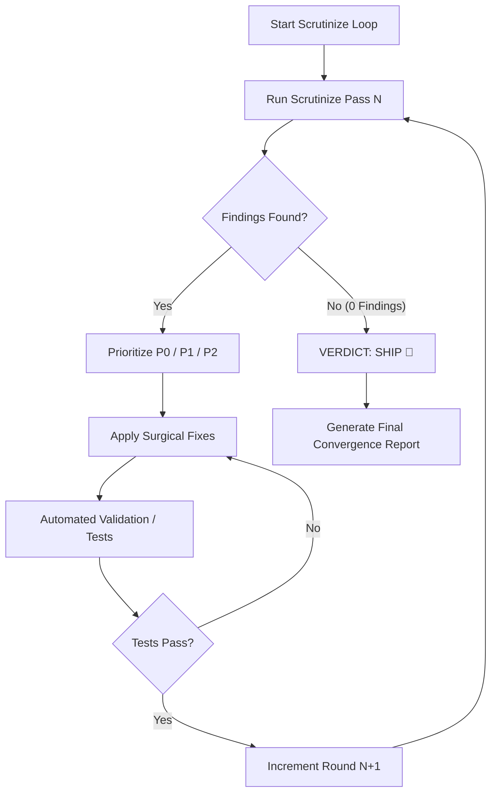

# Scrutinize Loop (Iterative Review & Repair Engine)

An autonomous convergence loop that combines outsider-perspective scrutiny with surgical repairs. It iterates continuously: **Review → Prioritize → Fix → Validate → Re-Review** until the codebase reaches **Zero Findings (VERDICT: SHIP)**.

> [!IMPORTANT]
> **Prerequisite:** This skill strictly requires the **`scrutinize`** skill (`~/.agents/skills/scrutinize/SKILL.md`) as its foundational review engine. Read and adhere to `scrutinize`'s 3-step evaluation discipline (Intent → Trace → Verify) on every pass.

---

## Operating Principles

1. **Autonomous Convergence**: Do not stop at the first fix. If bugs or code defects are discovered, fix them immediately, run automated verification, and immediately trigger the next Scrutinize round.
2. **Cold-Eye Scrutiny on Each Round**: Treat the newly modified code as if someone else wrote it. Trace the new code paths end-to-end to catch secondary bugs or unintended regressions introduced by the fix.
3. **Surgical, Root-Cause Fixes**: Do not apply shotgun changes or mask symptoms. Use the discipline from `debug-mantra` to address the core mechanism.
4. **Safety & Termination Gate**: Default loop safety limit is **5 iterations**. If findings do not converge to zero within 5 rounds, halt, document the oscillation/blocker, and request user guidance.

---

## The Convergence Loop Protocol



---

## Detailed Step-by-Step Workflow

### Step 1: Initialize Scope & Baseline
- Identify target files, modules, PRs, or feature boundaries.
- Ensure all prerequisite skills (`scrutinize`, `debug-mantra`) are loaded.
- Initialize the iteration counter: `Round = 1`.

### Step 2: Execute Scrutinize Pass
Apply the full 3-step `scrutinize` workflow:
1. **Intent**: What is the code/feature trying to do? Is there a simpler, more elegant architecture?
2. **Trace**: Walk the actual runtime code paths, entry points, state mutations, error branches, and call sites.
3. **Verify**: Test edge cases, concurrency, race conditions, memory leaks, boundary limits, and silent regressions.

### Step 3: Decision Gate (Evaluate Findings)
- **If 0 findings found**:
  - Output `VERDICT: SHIP`.
  - Proceed to Step 6 (Final Convergence Report) and terminate loop.
- **If findings > 0 found**:
  - Itemize each finding with severity:
    - **P0 (Blocker)**: Crashes, data corruption, security vulnerability, deadlocks.
    - **P1 (Defect)**: Functional failure, race condition, resource leak, broken contract.
    - **P2 (Quality/Edge)**: Unhandled edge case, layout defect, ungraceful error message.
  - Proceed to Step 4.

### Step 4: Surgical Repair & Refactor
- Formulate a precise fix for each finding.
- Modify code surgically with minimal diff footprints.
- Preserve documentation integrity and existing comments.
- Avoid introducing unnecessary external dependencies.

### Step 5: Automated Validation & Regression Check
- Run existing automated test suites (e.g. `pytest`, `npm test`, custom reproduction scripts).
- If tests fail, diagnose immediately using `debug-mantra` before proceeding.
- Once tests pass cleanly, increment round counter (`Round = Round + 1`) and **loop back to Step 2**.

### Step 6: Final Convergence Report
When 0 findings remain, compile the final summary report for the user:

```markdown
# 🏁 Scrutinize Loop Convergence Report

## Summary
- Total Iterations: X Rounds
- Total Findings Resolved: Y Issues
- Final Verdict: **SHIP 🚀**

## Iteration History
| Round | Findings Detected | Status | Key Fixes |
|-------|-------------------|--------|-----------|
| 1     | 3 (1 P0, 2 P1)    | FIXED  | Fixed race condition, clamped buffer bounds |
| 2     | 1 (P2)            | FIXED  | Handled touch scroll boundary on mobile |
| 3     | 0                 | CLEAN  | Perfect verification, 0 issues remaining |

## Code Integrity Verification
- [x] All automated tests passing (100%)
- [x] Concurrency & Race condition checks clean
- [x] Edge-case & Boundary limits validated
- [x] Production ready
```

---

## When to Trigger this Skill

- Trigger when the user asks:
  - `/scrutinize-loop` or `/autofix-loop`
  - *"Scrutinize แล้วเจอบัคแล้วแก้ วนไปเรื่อยๆ จนกว่าจะไม่เจอ"*
  - *"ตรวจ Scrutinize และแก้ปัญหาจนกว่าจะสะอาด 100%"*
  - *"Run iterative scrutinize and auto-repair until SHIP"*
  - *"Audit and auto-fix loop"*
